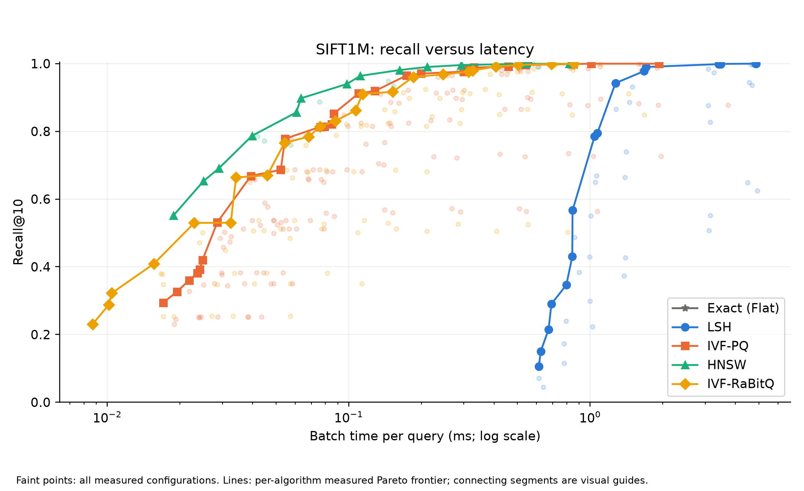
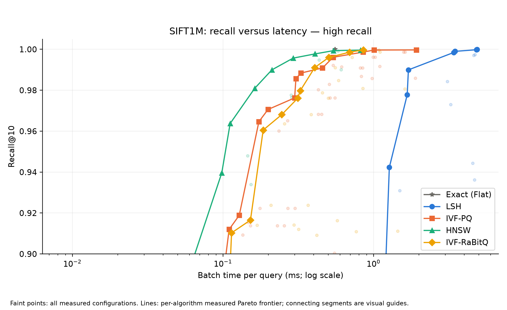
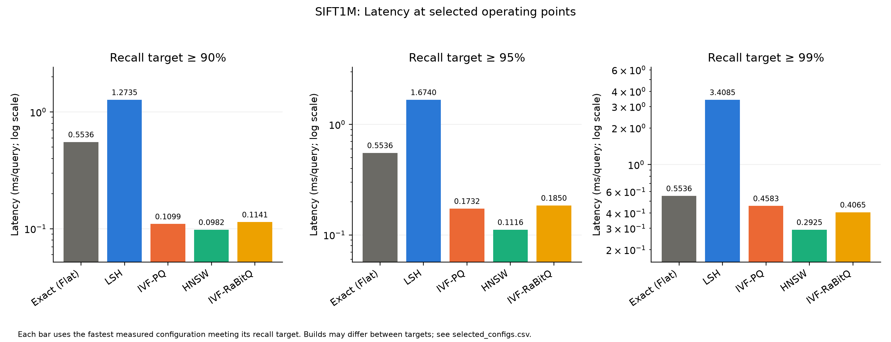
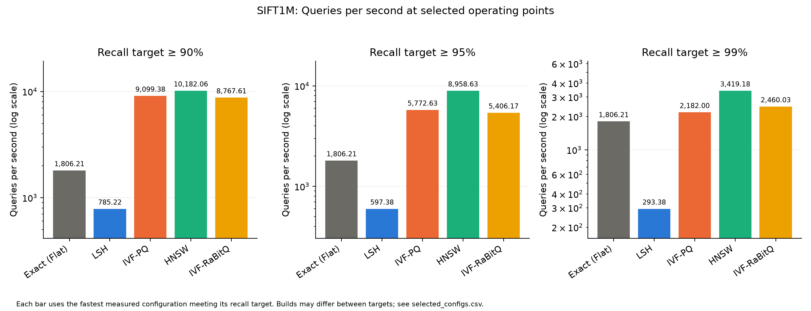
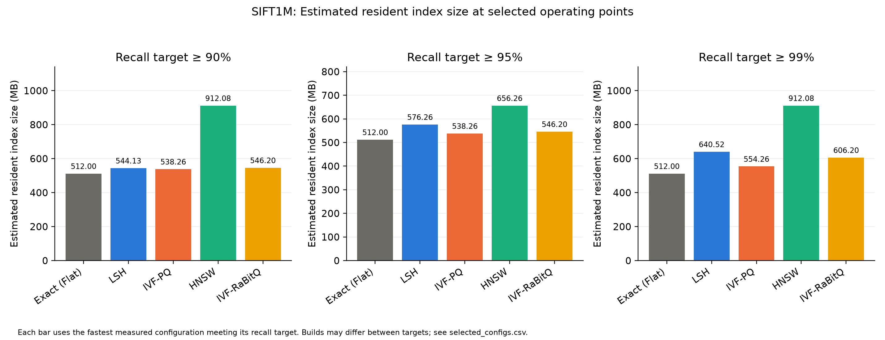
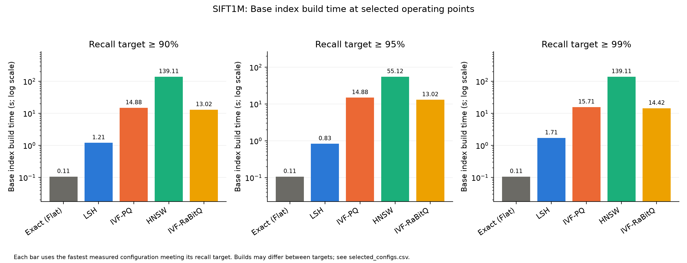
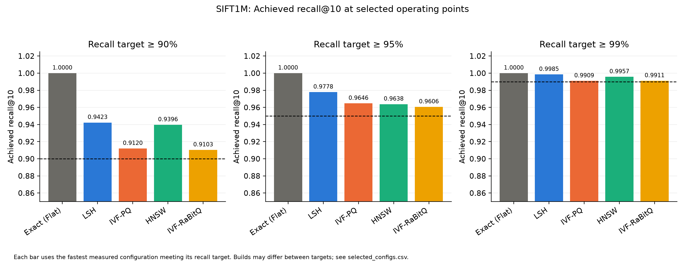
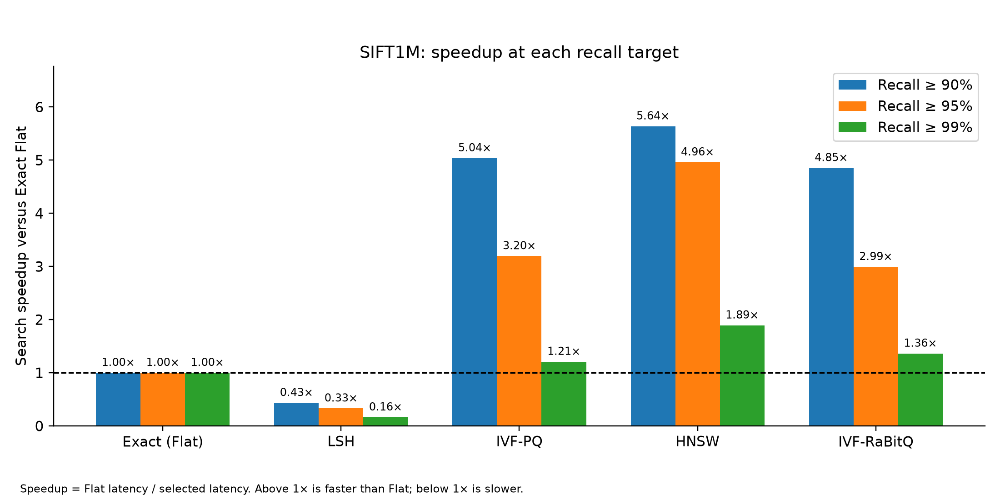
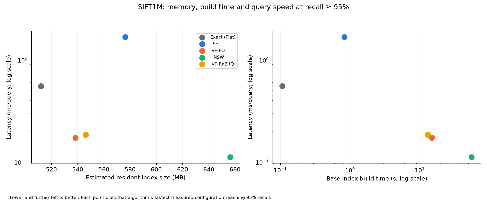
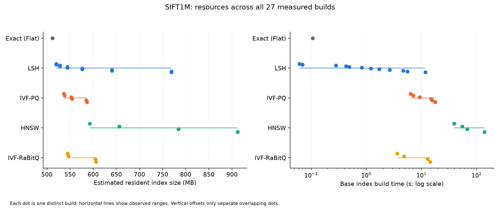

# SIFT1M: recall, search latency and resource comparison

This document pairs each plot with a caption and an interpretation that can be copied into a report. Insert the corresponding PNG beneath its caption in Google Docs. PDF versions of each figure are also available for export.

[All figures in one PDF](all_comparisons.pdf) · [Detailed benchmark tables and parameters](../report.md)

## Figure-to-section guide

| Report section | Figure | Image file |
| --- | --- | --- |
| Recall versus search latency | Figure 1: full recall range | recall_latency_all.png |
| Recall versus search latency | Figure 2: high-recall detail | recall_latency_high.png |
| Search latency comparison | Figure 3: latency at recall targets | latency_targets.png |
| Search throughput comparison | Figure 4: queries per second | throughput_targets.png |
| Memory consumption comparison | Figure 5: memory at recall targets | memory_targets.png |
| Index build time comparison | Figure 6: build time at recall targets | build_targets.png |
| Recall achieved by selected configurations | Figure 7: achieved recall | achieved_recall_targets.png |
| Speed relative to exact search | Figure 8: speedup over Flat | speedup_targets.png |
| Performance trade-offs | Figure 9: resources versus latency | resource_latency_tradeoffs.png |
| Sensitivity to build configuration | Figure 10: all-build resource ranges | all_build_resources.png |

For a shorter report, use Figures 1, 3, 5, 6 and 9, followed by the key findings below. Figures 2, 4, 7, 8 and 10 provide additional detail.

## Experimental setup and interpretation

The benchmark compares Exact Flat, LSH, IVF-PQ, HNSW and IVF-RaBitQ on SIFT1M, containing 1,000,000 unnormalised 128-dimensional vectors. Search uses squared Euclidean distance and returns the top 10 neighbours for 2,000 evaluation queries. The results contain 339 measured search configurations across 27 distinct builds, covering the configured grid under the benchmark's early-stopping rules. Measurements were recorded on an Apple M4 with Faiss 1.15.1.

Recall@10 is tie-aware, using a relative distance tolerance of 1e-4. Search runs with one Faiss/BLAS thread after warm-up, retaining the best of up to three timed batches. Reported latency is batch duration divided by the number of queries; it does not measure individual-request latency or tail latency. Index construction uses 10 configured threads.

Memory is estimated from serialized base-index size plus retained float32 vectors for exact reranking. LSH, IVF-PQ and IVF-RaBitQ each retain an additional 512 MB of raw vectors. Estimates exclude process overhead, temporary buffers and peak training RAM. Build time includes base-index training and insertion, excluding refinement-wrapper construction, disk loading and serialization. MB denotes decimal megabytes.

For each recall target, the comparison selects the fastest measured configuration reaching or exceeding that target. The selected build may change between targets, and achieved recall may exceed the threshold. These results describe the measured grid on this machine; small timing differences have no confidence intervals.

## Figure 1. Recall versus search latency



**Caption:** Recall@10 versus single-threaded batch time per query for all five algorithms on SIFT1M. Faint points represent measured configurations, while lines connect each algorithm's measured Pareto frontier. Latency uses a logarithmic scale; higher recall and lower latency are preferable. Connecting lines are visual guides, not additional measurements.

**Interpretation:** HNSW provides the lowest measured latency at the selected 90%, 95% and 99% recall targets. IVF-PQ and IVF-RaBitQ also improve on exact-search latency at these targets. LSH is slower than Exact Flat at all three targets, despite its short construction times. The curves show that the preferred algorithm depends on the required recall and the available resource budget.

## Figure 2. Recall versus latency at high recall



**Caption:** Detail of the recall–latency comparison for recall@10 between 0.90 and 1.00. All configurations and frontier lines follow the same conventions as Figure 1.

**Interpretation:** At recall of at least 99%, the fastest measured HNSW configuration takes 0.2925 ms/query, compared with 0.4065 ms for IVF-RaBitQ and 0.4583 ms for IVF-PQ. Exact Flat achieves full recall at 0.5536 ms/query. IVF-RaBitQ overtakes IVF-PQ at this target, although IVF-PQ is faster at the 90% and 95% targets.

## Figure 3. Search latency at fixed recall targets



**Caption:** Lowest measured latency for each algorithm at recall@10 targets of 90%, 95% and 99%. Each panel selects configurations independently. Latency axes are logarithmic; bar labels show ms/query.

**Interpretation:** At the 95% target, HNSW achieves 0.1116 ms/query, followed by IVF-PQ at 0.1732 ms and IVF-RaBitQ at 0.1850 ms. Flat takes 0.5536 ms and LSH takes 1.6740 ms. HNSW is approximately 1.55 times faster than IVF-PQ at these selected operating points. Higher recall targets increase the minimum measured search time for each approximate method.

## Figure 4. Search throughput at fixed recall targets



**Caption:** Queries per second for the fastest measured configuration of each algorithm at each recall target. Higher values indicate greater throughput under the single-threaded batch workload.

**Interpretation:** At the 95% target, HNSW processes approximately 8,959 queries/s, IVF-PQ 5,773 queries/s and IVF-RaBitQ 5,406 queries/s. Flat processes approximately 1,806 queries/s, while LSH processes 597 queries/s. Throughput is the reciprocal of the batch time per query, so this figure presents the same timing results as Figure 3 in capacity terms.

## Figure 5. Memory consumption comparison



**Caption:** Estimated resident index size for each algorithm's fastest measured configuration at each recall target. Values include raw vectors retained for exact reranking, but exclude runtime overhead and temporary allocations.

**Interpretation:** At the 95% target, Flat uses 512.0 MB, IVF-PQ 538.3 MB, IVF-RaBitQ 546.2 MB, LSH 576.3 MB and HNSW 656.3 MB. Compressed methods exceed Flat's size because they retain both compressed representations and raw vectors for refinement. At the 90% and 99% targets, the selected HNSW build uses approximately 912.1 MB. This change reflects independent selection of the fastest build at each target; it does not imply that HNSW memory must decrease as recall increases.

## Figure 6. Index build time comparison



**Caption:** Recorded training-plus-insertion time for the base index used by each selected operating point. Build-time axes are logarithmic. Cached construction measurements are reused across search configurations sharing the same build.

**Interpretation:** At the 95% target, Flat builds in approximately 0.107 s and LSH in 0.831 s. IVF-RaBitQ takes 13.02 s, IVF-PQ 14.88 s and HNSW 55.12 s. HNSW therefore trades a longer construction phase for faster queries. Flat is attractive when exactness or frequent rebuilding matters, while HNSW's larger construction cost may be justified when many queries reuse an index.

## Figure 7. Recall achieved by selected configurations



**Caption:** Actual recall@10 achieved by the fastest configurations meeting each target. Dashed horizontal lines indicate the target. The vertical range starts at 0.85 to show differences between high-recall operating points.

**Interpretation:** Configurations are compared using minimum recall requirements rather than identical achieved recall. At the 95% target, HNSW achieves approximately 96.38%, IVF-PQ 96.46%, IVF-RaBitQ 96.06% and LSH 97.78%; Flat achieves 100%. Overshoot results from the discrete parameter grid and should be considered when interpreting timing differences.

## Figure 8. Speedup relative to Exact Flat



**Caption:** Exact Flat latency divided by the selected algorithm's latency at each recall target. Values above 1 indicate faster search than Flat; values below 1 indicate slower search.

**Interpretation:** At the 95% target, HNSW is approximately 4.96 times faster than Flat, IVF-PQ 3.20 times faster and IVF-RaBitQ 2.99 times faster. LSH achieves only 0.33 times Flat's throughput, corresponding to roughly three times its latency. Approximate search therefore provides a speed advantage only for suitable algorithms and configurations in this experiment.

## Figure 9. Resource and latency trade-offs



**Caption:** Search latency versus estimated memory (left) and base-index build time (right), using each algorithm's fastest measured configuration reaching 95% recall. Lower latency and smaller resource requirements are preferable. Latency and build time use logarithmic scales.

**Interpretation:** HNSW provides the fastest queries but requires more memory and construction time than the selected IVF methods. IVF-PQ takes approximately 1.55 times HNSW's query time, while saving about 118 MB and building about 3.71 times faster. IVF-RaBitQ builds faster than IVF-PQ but is slightly slower in search and uses slightly more memory at this target. Flat has the lowest estimated index size and shortest build time, with slower queries than the three leading ANN methods.

## Figure 10. Resource ranges across all measured builds



**Caption:** Estimated memory and base-index construction time across all 27 distinct builds. Each dot represents one build, and horizontal lines show each algorithm's observed range. Vertical offsets separate overlapping dots and carry no measurement meaning.

**Interpretation:** HNSW spans approximately 592.6–912.1 MB and 39.22–139.11 s across the measured build configurations. IVF-PQ spans 536.7–586.3 MB and 6.35–17.79 s, while IVF-RaBitQ spans 544.6–606.2 MB and 3.62–14.42 s. LSH spans 520.0–769.1 MB and 0.061–11.80 s. These ranges show resource variation across the configured builds; they do not establish equal recall or latency across those builds. Some LSH builds are faster to construct than Flat, although Flat builds fastest among the configurations selected for the three recall targets.

## Key findings and best-performing algorithms

HNSW is the best-performing algorithm for measured query latency at the 90%, 95% and 99% recall targets. Its advantage comes with higher memory consumption and longer construction times. It is therefore most attractive when query speed is the main requirement and construction cost can be amortized over many searches.

IVF-PQ offers a strong balance of search speed, memory and construction time around 90–95% recall. At the 95% target, it reaches approximately 96.46% recall in 0.1732 ms/query using 538.3 MB, with a 14.88 s base build. IVF-RaBitQ is another useful compromise: it builds faster at the selected 95% operating point and achieves lower latency than IVF-PQ at the 99% target, with higher memory use.

Exact Flat achieves full recall and has the smallest estimated resident index size in this reranking setup. It also has the shortest build time among the configurations selected at the three recall targets. LSH builds quickly but is slower than Flat at every selected target, making it an unattractive choice for high-recall SIFT1M search on this machine.

These findings cover all five algorithms in the main SIFT1M benchmark. PQ-only and IVF-Flat have no measurements in this comparison and are not ranked. The results do not establish a universal winner across machines, datasets or parameter grids.

## Reproducing the figures

Run from the repository root:

```bash
venv/bin/python -m scripts.sift_report
venv/bin/python -m scripts.sift_comparison_plots
```

Inputs: `results/sift.csv`, `../selected_configs.csv` and `../all_builds.csv`. The plotting script regenerates PNG/PDF figures and a basic gallery in `gallery.md`. This README retains the expanded report text when plots are regenerated.
